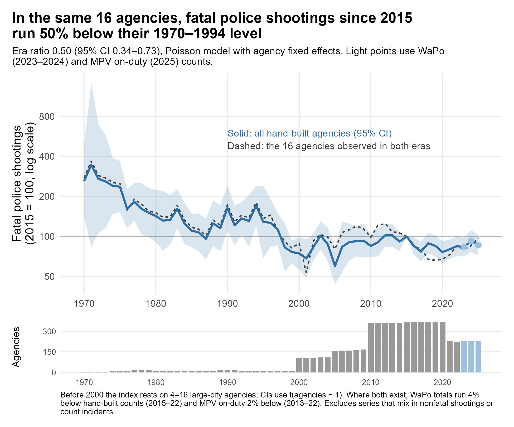
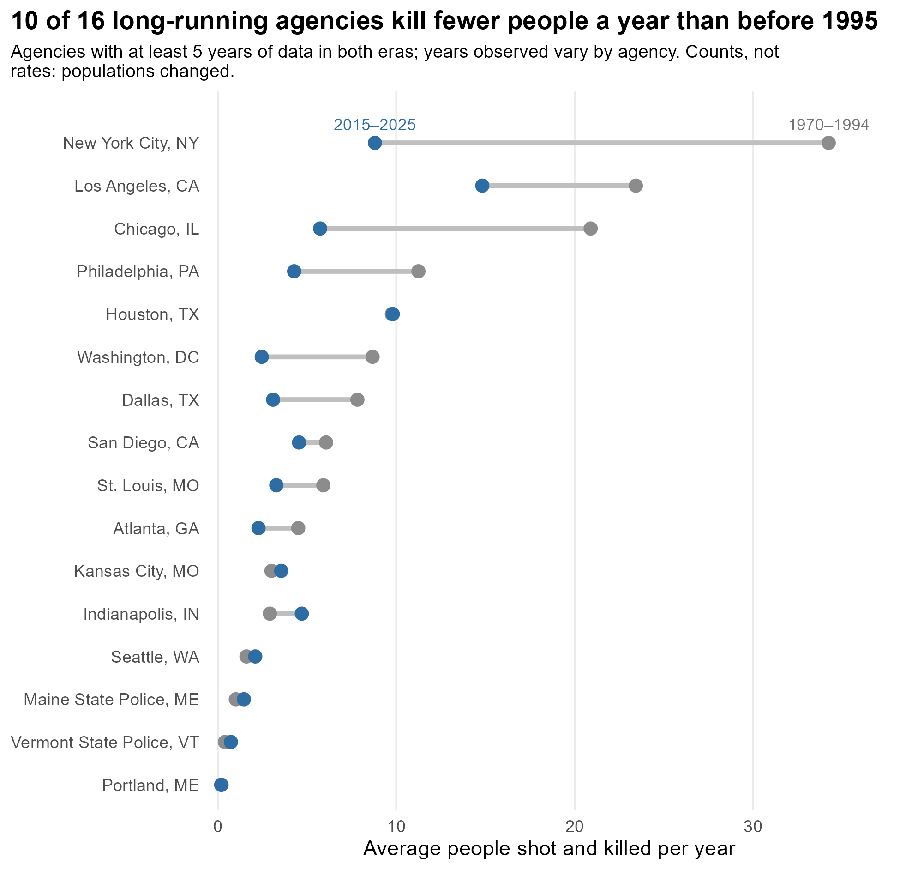
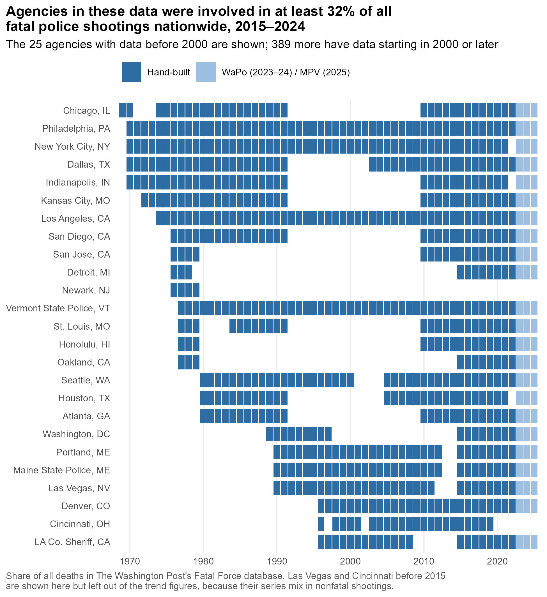

> When aggregating all races, the age-standardised mortality rate due to police violence was 0·25 (0·24–0·26) per 100 000 in the 1980s and 0·34 (0·34–0·35) per 100 000 in the 2010s, an increase of 38·4%…

That's from a [2021 paper in *The Lancet*](https://doi.org/10.1016/S0140-6736(21)01609-3) by the Global Burden of Disease police violence collaborators. Its headline finding got most of the attention, and deservedly so: death certificates missed more than half of all deaths from police violence between 1980 and 2018. But the line above made its way into a lot of conversations too, usually compressed into something like "police are killing more people now than in the 1980s."

I wasn't so sure. That paper is the reason I started building an [agency-level dataset](https://github.com/jnixy/agency-level-fatal-OIS) of people shot and killed by police, going back as far as I could find records. This post explains why I was skeptical, what I've done with the data since, and what it can and can't tell us.

## What the Lancet paper did

The authors started with four sources:

- **Death certificates** (the [National Vital Statistics System](https://www.cdc.gov/nchs/nvss/index.htm), or NVSS), back to 1980;
- **[Fatal Encounters](https://fatalencounters.org/)**, from 2005;
- **[Mapping Police Violence](https://mappingpoliceviolence.org/)**, from 2013;
- ***The Guardian*'s [The Counted](https://www.theguardian.com/us-news/series/counted-us-police-killings)**, for 2015–16 only.

They treated The Counted as the gold standard. A "network meta-regression" then estimated how much each of the other three sources over- or under-counted relative to it, in each state and racial group. Each source was scaled up or down by its correction factor, and a smoothing model was fit through all of the corrected numbers from 1980 to 2019.

That's a reasonable way to fix an undercount. The question is what it does to a trend.

## Why I was skeptical

Before 2005, the only data going into the model are death certificates. So the estimate for the 1980s is, in effect, the number of police-violence deaths recorded on death certificates in the 1980s, multiplied by how badly death certificates undercounted those deaths *in 2015 and 2016*. The model lets that undercount vary by state, race, and the share of deaths involving a firearm. Otherwise, it assumes death certificates missed police killings at the same rate in 1980 as they did 35 years later.

That matters because raw death-certificate counts roughly doubled over the period, from about 300 a year in the early 1980s to about 600 by 2018.[^1] If the undercount rate stayed the same, that doubling carries straight through to the corrected estimates. But if medical examiners and coroners simply got better at recording police involvement over those decades, part of the "increase" is the paperwork catching up — not more people dying.

There's a similar issue on the back end. Fatal Encounters' counts climb from roughly 900 deaths in 2005 to about 1,450 in 2019. The model assumes Fatal Encounters' coverage, relative to The Counted, held steady across all of those years. But the sources it's checked against don't exist before 2013. The authors dropped Fatal Encounters' 2000–2004 data over completeness concerns, so they knew early coverage was an issue; they just drew the line at 2005.[^mpv]

None of this means the Lancet estimates are wrong. It means the long-run trend rests on an assumption that can't be checked with the data in the paper. Two smaller differences are worth noting too:

- **Scope.** Their outcome includes every death from police violence (vehicle pursuits, restraint, and so on), not just shootings.
- **Rates, not counts.** The U.S. population grew by about 45% over the period, so a steady number of deaths would show up as a falling rate.

What we need is a different kind of record: one that doesn't depend on how death certificates were coded. Many police departments have tracked their own shootings for decades. So I started collecting those counts, agency by agency.

## What I've done since

The dataset has grown slowly, one source at a time:

- Geller and Scott's *Deadly Force: What We Know* for the 1970s and 80s;
- news investigations in Florida, Georgia, Minnesota, and Utah;
- open data portals in cities like Dallas and Phoenix;
- a few departmental reports that VIPR Lab student [Ash Bruha](https://www.viprlab.org/author/ash-bruha/) tracked down.

It now covers 414 agencies.

This fall, with the help of an AI coding assistant ([Claude](https://www.anthropic.com/claude)), I rebuilt the whole thing:

- **One panel, four sources.** The repo now publishes a single agency-year panel with my counts side by side with *The Washington Post*'s Fatal Force data (2015–2024), Fatal Encounters (2000–2021), and Mapping Police Violence (2013–present). Mapping Police Violence is the one national source still updating, so the panel can keep growing. Linking Fatal Encounters meant matching its free-text agency names to FBI agency codes. Every match is either an exact name match or a decision I recorded by hand. About 89% of its fatal shootings now link to an agency.
- **Corrections to my own data.** Five agencies had been matched to the wrong FBI code. The old merge with the *Post*'s data had also missed 96 agencies listed under more than one code. 
- **A reproducible pipeline.** Every number, table, and figure is generated by code you can rerun.

Where the three sources overlap, they agree closely. My counts and the *Post*'s match exactly in 95% of agency-years.

## What the data show

The figure below compares each agency only to itself, using a statistical model that tracks changes within agencies over time.[^2] That way, agencies entering or leaving the data don't move the line.

**The headline comparison.** It uses the 16 agencies with at least five years of data both before 1995 and since 2015 (the dashed line). In those agencies, fatal police shootings since 2015 have run about half their 1970–1994 level. The best estimate is 50% lower, with an uncertainty range of 27% to 66% lower.

Here are those 16 agencies one by one:

Ten of the 16 kill fewer people a year now than before 1995:

| Agency | Before 1995 (per year) | Since 2015 (per year) |
|---|---:|---:|
| NYPD | about 34 | about 9 |
| Chicago | about 21 | about 6 |
| Los Angeles | about 23 | about 15 |

The pattern isn't uniform. Indianapolis is noticeably higher now, and a few smaller agencies are flat or slightly up. These are counts, not rates. Some of these cities have grown and others, like St. Louis and Philadelphia, have shrunk, so adjusting for population could move individual comparisons in either direction.[^3]

## What we can and can't say

**What we can say.** In the agencies we can follow for 50 years (mostly large cities) fatal police shootings are lower now than they were in the 1970s, 80s, and early 90s. That pattern sits uneasily with a national increase over the same period. If anything, it's consistent with the possibility that some of the Lancet paper's rise reflects better death-certificate coding rather than more killings.

**What we can't say.** Whether the *national* number of people killed by police is higher or lower than in the 1980s. Sixteen big cities aren't nationally representative, and my 414 agencies aren't a random sample of American police departments.

That's why depth matters as much as breadth here:

- **Breadth.** The agencies in my data were involved in at least 32% of everyone shot and killed by police nationwide from 2015 to 2024.
- **Depth.** Only 25 of them have any data before 2000, and several of those series have long gaps.

## Can you help?

If you know where historical counts of fatal police shootings live for *any* agency — an annual report, a consent decree filing, an old newspaper series, a dissertation appendix — I'd love to hear about it. Chicago from 1992 to 2009 would be a great start. Email me, or [open an issue](https://github.com/jnixy/agency-level-fatal-OIS/issues) on GitHub.

Claims about long-run national trends, in either direction, are still running ahead of the data. I'm hoping we can close some of that gap.

[^1]: These are my reads off the paper's Figure 2, which plots each source's raw annual counts before and after correction. The paper doesn't report the raw series in a table.

[^mpv]: Crowdsourced coverage growing over time isn't hypothetical. When I line up Mapping Police Violence against my own counts for the same agencies, it runs about 10% lower in 2013–15. By 2020–22 it runs a few percent *higher*. That's the pattern you'd expect if the database got better at finding deaths over time, which is exactly what it's supposed to do. But it means a trend built from a single crowdsourced source can drift upward on its own.

[^2]: For the curious: a Poisson regression with agency fixed effects, with 2015 as the reference year. The code is in [`scripts/07_figures_trends.R`](https://github.com/jnixy/agency-level-fatal-OIS/blob/main/scripts/07_figures_trends.R). Every number in this post comes from a table that script writes, so if I've gotten something wrong, it should be easy to find. Considerations: (1) My counts run through 2022. For 2023–24 I filled in the *Post*'s counts, and for 2025 MPV's. (2) I left out series that mix in nonfatal shootings or may count incidents rather than people. (3) Before 2000, the trend rests on just 4 to 16 big-city departments.

[^3]: The years observed in each era also vary by agency. DC's early window, for example, is 1989–94, the height of the crack era. The [table](https://github.com/jnixy/agency-level-fatal-OIS/blob/main/output/tables/then_vs_now.csv) lists each agency's years.
