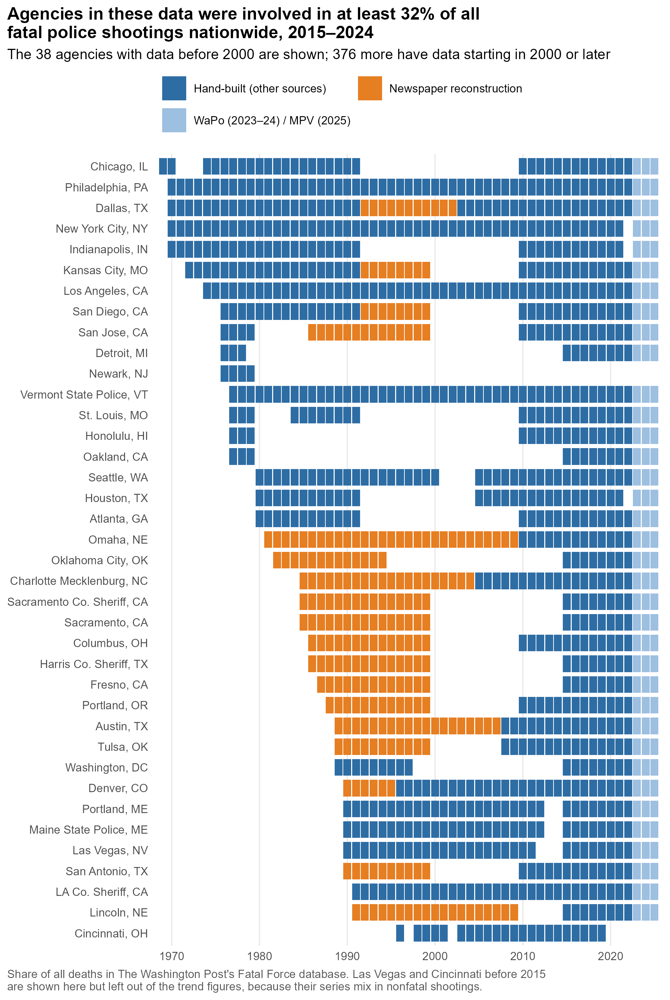
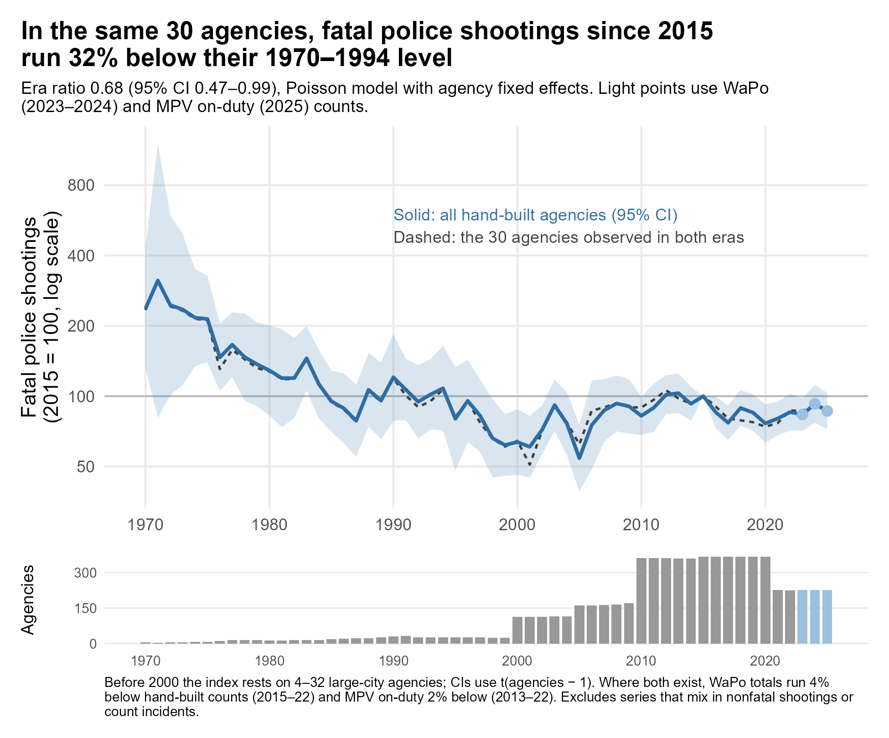
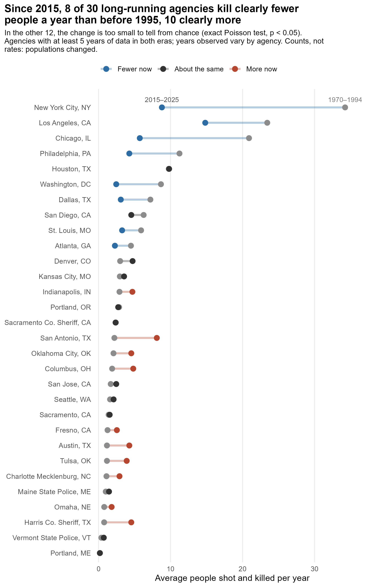

[Last week's post](/post/post38-police-killings-long-run/) ended with a plea: if you know where historical counts of fatal police shootings live, tell me. A week later, and I'm scouring old newspaper articles, and in my opinion it's been very productive.

## Why newspapers

The original plan was to find the records police departments kept themselves (e.g., annual reports, internal affairs summaries, use-of-force reviews). In practice, that well ran dry fast. The [Wayback Machine](https://web.archive.org/) only began saving web pages in 1996, and the reports departments posted online mostly covered the 2000s, a decade [Fatal Encounters](https://fatalencounters.org/) already covers. Where older annual reports did turn up, they usually counted shooting *incidents*, not people killed. A six-agency pilot produced exactly two new years of usable counts (Jacksonville, 2007 and 2008).

Local papers, on the other hand, covered nearly every police killing in their city, and many of them are now digitized and searchable through [NewsBank](https://www.newsbank.com/)'s Access World News. Some papers made it easy. The *Omaha World-Herald* ran a running sidebar after each police killing listing every one in the past decade. Most papers didn't, so for most cities I rebuilt each year case by case.[^ai]

## How it works

For my purposes, a death counts when the paper reports that an on-duty officer of that agency shot and killed someone. Off-duty officers, other agencies at the same scene, and suicides during standoffs are left out.[^rules]

For each agency-year, I searched the paper several ways: full-text searches pairing kill phrases ("shot and killed," "fatally wounded") with the agency's name, headline searches, and stories about prosecutors' reviews of each shooting, which in some places, like Texas, means a grand jury. Each search window ran to January 15 of the following year. Every case (and every exclusion) is logged with the article and its database ID in an [evidence file](https://github.com/jnixy/agency-level-fatal-OIS/blob/main/data/historical/historical_ois_evidence.csv), so anyone with access can check my work. Where a paper printed its own count (e.g. "the city's fifth fatal police shooting this year"), I checked the reconstruction against it.

On the one hand, this method's weakness is that it can miss deaths. If a story never ran, or ran under wording none of my searches anticipated, that death is missing. So the reconstructed counts are best read as floors. It also only reaches back as far as each paper's archive (mostly the mid-1980s), and some cities are simply out of reach. Detroit's papers aren't in the database before 1995, and the *Los Angeles Times* isn't in NewsBank at all.

## What it added

Seventeen newspapers have now filled in years for 18 agencies, from Omaha and Oklahoma City to San Jose, Dallas, San Diego, and Kansas City: 251 agency-years and 396 people fatally shot. The orange tiles below are the newspaper years that just got added.

Last week, 25 agencies had any data before 2000. Now 38 do. More to the point for the long-run question, the number of agencies with at least five years of data both before 1995 and since 2015 has grown from 16 to 30.

## Checking the papers against the FBI

How do I know the newspaper counts are any good? One rough check is the FBI's [Supplementary Homicide Reports](https://cde.ucr.cjis.gov/) (SHR), in which agencies are supposed to report every homicide, including people killed by police. I merged them into the panel using [Jacob Kaplan's](https://jacobdkaplan.com/) cleaned files. SHR is a crude yardstick. It's [long been known](https://doi.org/10.2105/AJPH.93.7.1117) to miss a large share of police killings nationally. Some agencies skip years or never report their own officers' killings. And there's no field indicating whether the officer was on- or off- duty.

Even so, the comparison is reassuring. In the agency-years both sources cover, the newspaper reconstructions count 381 deaths and SHR counts 409, and the two match exactly in 132 of 234 agency-years. SHR running a little high is about what you'd expect, since it includes off-duty killings and my newspaper searches can miss cases.

Why not just use SHR, then? It goes back to 1976 and covers thousands of agencies. If it could be trusted, none of this newspaper reading would be necessary. But agency by agency, it has holes you could drive a patrol car through. From 1990 to 1995, Kansas City police killed at least 18 people; SHR records two. In 1993, the *Kansas City Star* reported that city police had killed three people that year, and SHR says none. It's the same story elsewhere. SHR shows no police killings in San Antonio in any year from 1990 to 1999, while the *Express-News* reconstruction finds 20. For Dallas from 1987–91, the department's own figures (published by Geller and Scott) come to 30; SHR has 12. And the gaps aren't just ancient history: SHR records no killings by NYPD officers from 2007 through 2014, years in which they shot and killed 84 people, and none by Chicago police from 2016 through 2022, when they killed 38.[^shrdata]

## The headline moved

That brings me to an update. Last week I reported that in the 16 long-running agencies, fatal police shootings since 2015 ran about half their pre-1995 level. With 30 agencies, that gap narrows: shootings since 2015 run 32% below the 1970–1994 level, with an uncertainty range of 1% to 53% lower.

Why the change? It comes from *which* cities were added. Drop the newspaper years and the model returns last week's answer exactly; take the 17 newspaper agencies on their own, and the ratio is 1.34. Most of the agencies I've just added *do* appear to be fatally shooting more people now than before 1995.

Many of those cities are fast-growing Sun Belt departments — San Antonio, Austin, Harris County — and these are raw counts, not rates. San Antonio's population has grown by more than half since 1990.[^pop] Could the newspapers' misses explain the rest? To check, I raised every newspaper year to SHR's count wherever SHR was higher, which overcorrects, since SHR also counts off-duty killings. The newspaper cities drop to 1.23 (still, on balance, above their pre-1995 level), and the headline barely moves (0.67).[^bound] Of the 30 agencies, 8 kill clearly fewer people a year now than before 1995, 10 kill clearly more, and 12 haven't changed by more than chance would explain.[^test]

So the picture is more mixed than last week's post suggested. The country's biggest departments (New York, Chicago, Los Angeles) are well below where they were. A lot of mid-sized and growing departments aren't.

Still, recall what the Lancet estimate implies: with population growth, roughly twice as many deaths a year in the 2010s as in the 1980s. Taken together, these 30 agencies show nothing like that. The pooled estimate is a 32% decline, and even the top of its uncertainty range is no increase at all. That's not true of every agency. But what I've seen so far is not at all what a doubling would look like.

## Using the data

Every agency in the panel carries its FBI ORI code, the identifier most federal crime and policing data use. That makes these counts easy to merge with other data. A few possibilities:

- **The [Law Enforcement Management and Administrative Statistics](https://bjs.ojp.gov/data-collection/law-enforcement-management-and-administrative-statistics-lemas) survey and the [Census of State and Local Law Enforcement Agencies](https://bjs.ojp.gov/data-collection/census-state-and-local-law-enforcement-agencies-csllea)** for agency size, policies, and training;
- **The FBI's Uniform Crime Reports**: crime counts, officer staffing, and assaults on officers, which Kaplan has [cleaned and documented](https://ucrbook.com/), to ask whether shootings track violent crime or attacks on officers;
- **Census and American Community Survey data**, through the [Law Enforcement Agency Identifiers Crosswalk](https://www.icpsr.umich.edu/web/NACJD/studies/35158), which links ORIs to Census place and county codes, to turn counts into rates;
- **The FBI's [National Incident-Based Reporting System](https://www.fbi.gov/how-we-can-help-you/more-fbi-services-and-information/ucr/nibrs)** (NIBRS) for more recent, incident-level crime data.

Population-adjusted rates are the obvious next step for the then-vs-now comparison. I'll get there, eventually, or would be happy to collaborate.

## What's next

Next up is Chicago, whose record stops in 1991 and doesn't pick up again until 2010. Those were not quiet years. Indianapolis, which has the same gap, turns out to be out of reach: its papers aren't in NewsBank.

If you can reach a paper I can't, I'd still love to hear from you. In particular, anyone with access to the *Los Angeles Times* archive (for the LA County Sheriff in 1989–90), the *Detroit Free Press* and *Detroit News* before 1995, or the *Indianapolis Star* in the 1990s could fill real gaps. Email me, or [open an issue](https://github.com/jnixy/agency-level-fatal-OIS/issues) on GitHub.

Seventeen newspapers in, the long-run record is broader than it was a week ago, and a bit less tidy. That's usually what more data does.

[^ai]: As with the rebuild I described last week, I had help from [Claude](https://www.anthropic.com/claude), which drafted a case log for each year. I made the calls on the edge cases. Every case it logged links back to the article, so the work is checkable either way.

[^rules]: The off-duty rule costs some deaths. In Harris County, for example, most of the gap between my count and SHR's is deputies working uniformed extra jobs. I kept the rule anyway, because the modern sources I compare against are built around on-duty killings and I wanted the old and new eras measured the same way. A few edge cases (a joint raid with federal agents, a suspect who followed an undercover officer home) are flagged in the evidence file.

[^pop]: From about 936,000 in 1990 to about 1.5 million today, per the Census Bureau. Austin roughly doubled over the same period.

[^shrdata]: Every count in this paragraph is in the panel ([`agency_year_panel.csv`](https://github.com/jnixy/agency-level-fatal-OIS/blob/main/output/agency_year_panel.csv)), where `n_nix` sits beside `n_shr` for each agency and year. Each of these zeros comes from a year in which the agency did file SHR reports, for its other homicides. It just didn't report any killings by its own officers.

[^bound]: SHR files nothing for some of these agency-years, so the bound only raises years where SHR has a count. Both runs are in [`era_ratio_sensitivity.csv`](https://github.com/jnixy/agency-level-fatal-OIS/blob/main/output/tables/era_ratio_sensitivity.csv).

[^test]: "Clearly" means an exact Poisson test of each agency's yearly rate in the two eras, at the conventional 5% level. Last week's post counted every agency whose average was lower, however slightly, which is why it said 10 of 16 were lower. The [table](https://github.com/jnixy/agency-level-fatal-OIS/blob/main/output/tables/then_vs_now.csv) lists each agency's years and rates, and the robustness check is in [`era_ratio_sensitivity.csv`](https://github.com/jnixy/agency-level-fatal-OIS/blob/main/output/tables/era_ratio_sensitivity.csv).
