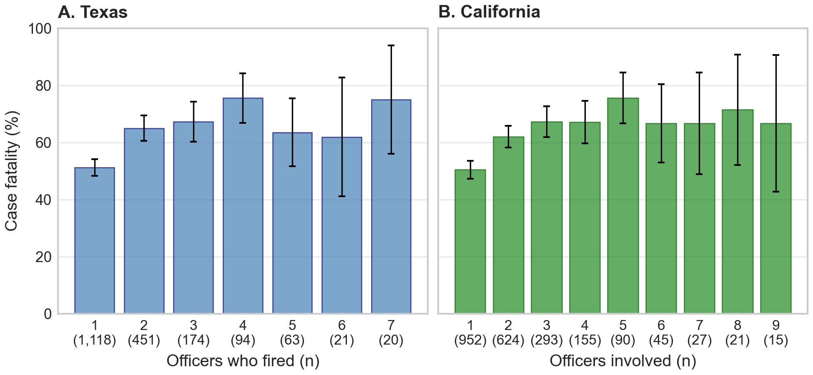

+++
# Paper title
title = "The Killing Cascade: More Officers, More Wounds, More Deaths in Police Shootings"

# Authors
authors = ["admin", "Ian Adams"]

# Publication
publication = "*Police Quarterly*"

# Publication types (2 = Journal article; 3 = preprint; 4 = report; 6 = book chapter)
publication_types = ["2"]

# Date the paper was published.
date = 2026-11-02T10:00:00Z

# Date this page was created.
publishdate = 2026-11-03T13:00:00Z

# Project summary to display on homepage.
summary = ""

# Abstract
abstract = "Among civilians shot by police, what distinguishes those who die from those who survive? Using mandatory reporting data on 4,207 civilians shot in Texas (2015–2025) and California (2016–2025), we examine two features rarely observed together: officer count and wound location. Fatality rose with officer count, mostly between one and two: adjusted predicted fatality went from 52.7% to 62.2% in Texas and 49.9% to 61.8% in California. The association persisted after adjustment for weapon type, civilian gunfire, contact reason, year, and agency, but moderate unmeasured confounding by severity could account for it. In California, wound location was the strongest correlate of fatality, and regions wounded statistically accounted for nearly two-fifths of the officer-count association. Exploratory analyses found wounds only in rear body regions more often among Black than White civilians (21.8% vs. 12.3%). These descriptive patterns imply one priority: record wound location for survivors and link it to trauma records."

# Tags: can be used for filtering projects.
# Example: `tags = ["machine-learning", "deep-learning"]`
tags = ["police shootings", "use of force", "race"]

# Optional external URL for project (replaces project detail page).
external_link = ""

# Slides (optional).
#   Associate this project with Markdown slides.
#   Simply enter your slide deck's filename without extension.
#   E.g. `slides = "example-slides"` references
#   `content/slides/example-slides.md`.
#   Otherwise, set `slides = ""`.
slides = ""

# Links (optional).
url_pdf = ""
url_slides = ""
url_video = ""
url_code = ""

# Custom links (optional).
#   Uncomment line below to enable. For multiple links, use the form `[{...}, {...}, {...}]`.
links = [{name = "Preprint", url="https://doi.org/10.21428/cb6ab371.874e801d", icon = "unlock-alt", icon_pack = "fas"}, {name = "DOI", url="https://doi.org/10.1177/10986111261507732"}, {name = "Replication Materials", url="https://github.com/jnixy/killing-cascade", icon = "code", icon_pack = "fas"}]

# Featured image
# To use, add an image named `featured.jpg/png` to your project's folder.
[image]
  # Caption (optional)
  caption = ""

  # Focal point (optional)
  # Options: Smart, Center, TopLeft, Top, TopRight, Left, Right, BottomLeft, Bottom, BottomRight
  focal_point = "Center"
+++

## UPDATE, 11.2.2026

Ian Adams and I learned yesterday that our paper, "[The Killing Cascade: More Officers, More Wounds, More Deaths in Police Shootings](https://doi.org/10.21428/cb6ab371.874e801d)," has been accepted at [*Police Quarterly*](https://doi.org/10.1177/10986111261507732). I wrote a summary of an earlier version here several months ago, while it was under review elsewhere. A fair amount has changed since then thanks to multiple rounds of demanding reviews and us adding another year's worth of data that have become available since we first wrote the paper. So I've revised this post to bring it in-line with the accepted version of the paper.

## The Killing Cascade

Roughly 1,000 people are killed by police gunfire every year in the United States. Another 800 or so survive. What distinguishes the two groups? That question has gotten surprisingly little attention. Most research on police shootings asks who gets shot in the first place. Who survives, conditional on being shot, is a different question, and it [requires more comprehensive data](https://doi.org/10.21428/cb6ab371.8b17fd57). You need records of nonfatal shootings too, and crowdsourced databases like the *Washington Post*'s [Fatal Force](https://github.com/washingtonpost/data-police-shootings/blob/master/README.md) only track deaths.

## What we did

We analyzed mandatory state reporting data on 4,207 people shot by police in Texas (2015–2025) and California (2016–2025). Both states require agencies to report every shooting that injures someone, fatal or not. Texas lists the officers involved in each shooting, which in practice reads as the officers who fired. California records how many officers were *involved* (a count that can include officers who never fired) and, unusually, the body regions where each person was struck. That difference in definitions is worth keeping in mind for everything that follows.

## More officers, more deaths, mostly at the second officer

People shot in incidents involving more officers were more likely to die. After adjusting for demographics, weapon type, the reason police were there, whether the person fired at officers, and the other circumstances each state records, predicted fatality rose from 52.7% to 62.2% in Texas when the count went from one officer to two. In California, it rose from 49.9% to 61.8%. Beyond two officers, the increments were smaller (one to two percentage points per additional officer) and less precise.

That's a change from how I described it before. The earlier version of this post emphasized a smooth dose-response: each additional officer adds about 3 points. Averaged across all counts, that's still roughly what the linear models show (3.7 points per officer in Texas, 3.2 in California). But the shape is mostly a step. The big difference is between one officer and more than one. The pattern held in all 21 robustness checks in Texas and all 30 in California, and comparing only shootings within the same agency barely moved it.

## Why? The data can't tell us

The number of officers who fire isn't assigned before an encounter; it's realized during one. Someone who is armed, shoots at officers, or keeps coming after the first shots will tend to draw more officers, more rounds, and more wounds, and may be more likely to die for reasons that have little to do with how many officers fired. Incidents with more officers in our data did look more dangerous. In California, for example, each additional officer was associated with a higher chance that the person had fired at police or was carrying a gun.

Adjusting for those markers barely changed the officer-count estimate, which is tempting to read as reassuring. It isn't, really. Our models explain little of the variation in who dies, and a sensitivity analysis suggests that unrecorded features of the encounter (rounds fired, distance, whether the person kept advancing, time to medical care) wouldn't need to matter very much to account for the whole association. So "killing cascade" describes a co-occurrence: more officers, more wounds, more deaths. It doesn't establish that a second officer's gunfire kills people who otherwise would have lived.[^1]

Contagious fire, where one officer's shots trigger reflexive firing by others, is still a plausible part of the story. In a [randomized simulation](https://doi.org/10.1016/j.jcrimjus.2024.102215), peer gunfire raised officers' odds of firing more than elevenfold. But independent responses to a genuine threat, poor coordination among officers converging on a scene, and plain encounter severity would all produce the same pattern in administrative data. Sorting them out requires knowing who fired first, the interval between shots, and how many rounds each officer fired. Body-worn camera footage linked to shooting records is the most promising source of that.

## Where bullets strike

California's wound data turned out to be the most informative part of the study. Where a person was struck was by far the strongest correlate of whether they died; adding wound location to the model nearly quadrupled the variance explained. People shot in incidents with more officers were also wounded in more body regions, and the number of regions wounded statistically accounts for about two-fifths of the officer-count association (39%, with a wide confidence interval).

## What about race?

We found no racial difference in head, chest, abdominal, or extremity wounds, so the data offer no support for the idea that officers' bullets strike Black or Hispanic civilians in more vital regions. But Black civilians more often had wounds recorded only in rear body regions: 21.8%, compared with 12.3% of White and 12.4% of Hispanic civilians. After adjusting for age, gender, and officer count, the Black–White difference was 8.3 percentage points. Adding weapon, incident circumstances, and whether the officer's narrative mentions flight narrowed it to 6.0 points, right at the edge of statistical significance.

To be clear about what that does and doesn't mean: California records the body regions wounded, not bullet trajectory, entry versus exit wounds, or the person's posture. A rear-only wound doesn't establish that someone was shot from behind. They may have turned in the fraction of a second between an officer's decision to fire and impact, and any flight recorded in an officer's narrative isn't an independent observation. We can't say, and don't claim, that officers shot fleeing people who posed no threat. What we can say is that the anatomical pattern differs by race, and that's worth pursuing with sources that can establish posture and sequence.

The rear-wound pattern also bears on the [previously documented](https://doi.org/10.1371/journal.pone.0259024) [Black–White fatality gap](https://ajph.aphapublications.org/doi/full/10.2105/AJPH.2023.307560) among people shot by police. Back wounds were far less often fatal than head or chest wounds, and adjusting for wound location erased the (already small) Black–White difference in California. So part of the lower fatality among Black civilians may reflect where they were struck. Not all of it, though: among head, chest, and abdominal wounds, Black civilians still died less often. And none of this speaks to who gets shot [in the first place](https://www.pnas.org/doi/10.1073/pnas.1821204116), where Black and Hispanic Americans remain overrepresented.

## What should happen next

Because these findings are descriptive, our policy recommendations are modest, and mostly about data.

First, more states should record wound location, and those records should link to trauma care. Of the two states we studied, only California records it, and I'm not aware of any other state that does so in its use-of-force reporting. Officers aren't the right source for anatomical detail anyway. Linking use-of-force records to trauma registries would capture wound location and severity for survivors and decedents alike, tell a graze from a penetrating injury, and record time to care. None of that depends on a causal claim about officer count.

Second, multi-officer tactics deserve rigorous evaluation. It's tempting to jump from our results to protocols aimed at the second shooter, but the data can't support that. What we can say is that fire-discipline training that emphasizes assessing after each shot, contact-and-cover tactics that limit crossfire, and supervisory review of multi-officer discharges are old ideas that have rarely been evaluated. One thing our findings should not be used for is arguing that fewer officers should respond to dangerous calls. Fewer officers firing is not the same as fewer officers on scene, and backup protects civilians and officers alike.

Third, whatever determines how many times someone is shot, survival depends partly on how quickly they reach care. Officer-delivered aid, tourniquets and chest seals in every patrol car, and transport protocols can all be pursued now, without waiting for the causal questions to be resolved.

We know a lot more about who gets shot by police than about who survives. Recording where people are wounded, for survivors as well as for those who die, is a relatively inexpensive way to start closing that gap.

[^1]: The earlier version of this post also estimated that 272 deaths would not have occurred if multi-officer shootings carried single-officer fatality rates. The published paper keeps a version of that calculation in an appendix, but frames it as a difference in expected deaths within our sample, not deaths that could have been prevented. Given the confounding problem, we think that framing is the right one.

